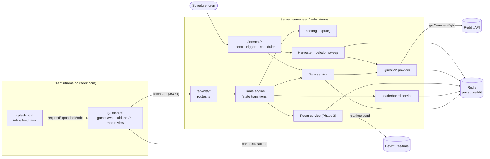

# Architecture

Stack (confirmed against the official template, Devvit 0.15.4): **Devvit Web · React 19 · TypeScript 6 · Vite 8 · Tailwind 4 · Hono (server) · Devvit Redis · Devvit Realtime · Devvit Scheduler.** No tRPC (the template's `AGENTS.md` mentioned it, but the template doesn't ship it). Plain `fetch` + shared TS types.

## 1. System diagram



## 2. Modules

| # | Module | Location | Role | Depends on |
|---|---|---|---|---|
| 1 | Client UI | `src/client/` (`splash.tsx`, `game.tsx`, `games/who-said-that/`) | Render state from the server, collect choices. Holds no answers. | shared contracts |
| 2 | Game engine | `src/server/games/who-said-that/engine.ts` (Phase 2) | Validates actions (`guess`, `hint`), advances player/room state, calls scoring | 3–7 |
| 3 | Question provider | `src/server/providers/questions.ts` ✅, `redditText.ts` ✅ | `QuestionRecord` from an approved case; validates and sanitizes Reddit comments; sample fallback | Reddit API, Redis |
| 3b | Harvester + sweep | `src/server/services/harvest.ts`, `sweep.ts`, `games/who-said-that/subreddits.json` (Phase 1b) | Collect candidates from whitelisted subs; auto-build distractors/explanation; re-check deletions | provider, Scheduler |
| 4 | Daily service | `src/server/services/daily.ts` ✅ (progress in Phase 2) | Picks today's 5 IDs, idempotent create, per-user progress | provider, Redis, `dateKey.ts` ✅ |
| 5 | Room service | `src/server/services/rooms.ts` (Phase 3) | Room lifecycle, round timers, realtime broadcasts | engine, Redis, Realtime |
| 6 | Scoring | `src/server/games/who-said-that/scoring.ts` ✅ | Pure `scoreRound()`; unit-tested | `WST` constants |
| 7 | Leaderboard | `src/server/services/leaderboard.ts` (Phase 4) | Sorted-set wrapper keyed by `{game}:{period}`; top N + my rank; streaks | Redis |
| 8 | Reddit integration | `src/server/core/post.ts` ✅, `routes/menu.ts` ✅, `routes/triggers.ts` ✅ | Create daily post, mod menu actions, install trigger | Reddit API |
| 9 | Storage | Redis only (no external DB) | See §4 | — |

Rule: **services are plain functions taking explicit inputs** (`dateKey`, `userId`), so they test with `node --test` without Devvit. Only route files import `context`.

## 3. Client vs. server responsibility

| Client | Server |
|---|---|
| Rendering, animation, countdown from server `endsAt` | Answers, shuffling, timing (`issuedAt`), scoring, distribution |
| Sends `{questionId, choice, hintsUsed}` | Rejects duplicate/late/out-of-order guesses |
| Caches nothing important (localStorage is wiped on app updates) | All persistent state in Redis |
| Never sees `answerSubreddit`/`threadTitle` before reveal | `PublicQuestion` vs `QuestionRecord` split enforces this |

**Auth:** identity = `context.userId` / `reddit.getCurrentUsername()` on the server. Never trust a user ID from the request body. No `userId` (logged out) → read-only. Mod-only actions check `forUserType: moderator` in `devvit.json` **and** re-check mod permissions server-side.

## 4. State and Redis keys

Redis is per subreddit, has no key scan, no lists/sets → every key is derivable from (`dateKey`, `userId`, `roomCode`); sorted sets replace sets/queues. Prefix every key with the game id.

| Key | Type | Contents | TTL |
|---|---|---|---|
| `wst:q:{qid}` | string (JSON) | `QuestionRecord` snapshot (comment text) | 7 d |
| `wst:case:{qid}` | string (JSON) | Approved case **metadata only**: commentId, answer, distractors, explanation | — |
| `wst:bank` | zset | qid → approved-at; pool of approved cases (seed + harvested) | — |
| `wst:cand` | zset | candidate id → harvested-at; review queue | — (members trimmed with their text) |
| `wst:cand:{cid}` | string (JSON) | Candidate text + thread title + sub, pending review | 3 d |
| `wst:seen` | zset | commentId → seen-at; never re-harvest (ID only) | trim > 60 d |
| `wst:cursor:{job}` | string | Batch cursor for harvest / sweep jobs | — |
| `wst:used` | zset | qid → dateKey-as-number used | — |
| `wst:daily:{date}` | hash | `qids` (JSON array), `postId`, `createdAt` | 30 d |
| `wst:play:{date}:{uid}` | hash | `round`, `issuedAt`, `results` (JSON), `total`, `doneAt` | 30 d |
| `wst:dist:{date}:{qid}` | hash | choice → count (`hIncrBy`) | 30 d |
| `wst:lb:{date}` | zset | uid → score (tie-break encoded as `score*1e7 - secondsSinceMidnight`) | 30 d |
| `wst:streak:{uid}` | hash | `last`, `count` | — |
| `wst:room:{code}` | hash | `host`, `status`, `round`, `endsAt`, `players` (JSON) | 2 h |

Daily creation is idempotent: `watch(daily key)` → if absent, pick + `multi/exec`. Triggered by the cron job **and** lazily by the first `GET /api/wst/daily` of the day.

## 5. Realtime flow (Party Room, Phase 3)

Realtime is **server → client broadcast only**. Clients act via HTTP; the server mutates Redis, then broadcasts.

```
client POST /api/wst/party/{code}/guess ─▶ server: validate, store, maybe close round
server ─ realtime.send("wst-room-{code}", event) ─▶ all clients in room
```

Channel `wst-room-{code}` (no `:` allowed). Events: `lobby` (players/ready), `round-start` (`PublicQuestion`, `endsAt`), `round-reveal` (answer, picks, scores), `end` (ranking). Every event carries `seq`. A client that sees a gap, or reconnects, calls `GET /party/{code}/state` for a full snapshot.

There is no long-running process, so rounds close by: last player's guess, **or** any client's `POST /party/{code}/tick` after `endsAt` (idempotent, guarded by a transaction), **or** a `scheduler.runJob` at `endsAt` as a backstop (≤ 60/min, fine at hackathon scale).

## 6. Content pipeline and deletion

Policy basis: `HACKATHON_REQUIREMENTS.md` §5. Only the Devvit `reddit` client, inside the app.

```
harvest (cron, small batches) → candidate queue (3 d TTL) → moderator review → bank → daily pick → serve
                       ↑                                                         ↑
                deletion sweep (cron) re-checks every stored text; deleted → drop text, keep ID
```

1. **Config:** `subreddits.json` lists ~40 public SFW subs, each with a `family` (e.g. cooking: castiron, Cooking, AskCulinary) and a one-line culture `blurb`. Humans write this once.
2. **Harvest** (`/internal/scheduler/harvest`, every 30 min): a cursor walks the list, ~5 subs per run to stay under the 30 s request limit. Per sub: `getTopPosts(week)` → top comments → skip `wst:seen` → `sanitizeCommentBody` + `checkCaseBody` + thread-title leak check → keep ≤ 3 per sub as candidates. Distractors: 2 from the same family, 1 from another, seeded by id. Explanation defaults to the sub's blurb.
3. **Review** (moderators only, in the expanded view): one candidate card at a time with Approve / Skip. Approve writes `wst:case:{qid}` + `wst:bank`; Skip deletes the text. Server re-checks mod permission.
4. **Seed cases** (`seed-cases.json`) enter the bank the same way; they are the fallback if the harvester is down.
5. **Daily pick** (`getOrCreateDaily`): `loadCase` re-validates live before a day goes live; snapshot `wst:q:{qid}` 7 d.
6. **Sweep** (`/internal/scheduler/sweep`, every 15 min, ~25 items per run): re-checks candidates and snapshots; deleted/removed/NSFW → delete the text keys and the bank entry, keep the ID in `wst:seen`. Today's daily drops a deleted case on next read and backfills from the bank.
7. **Removal:** moderator "Remove case" deletes all text for that qid.

Budget: ≤ 3 recurring jobs of the 10 allowed (rollover, harvest, sweep). Reddit API rate limits are UNVERIFIED, so batches stay small and are logged.

## 7. Adding a new mini-game (e.g. Reddit Courtroom)

1. Add the id to `GameId` in `src/shared/types/game.ts`.
2. Create `src/shared/games/<id>/contracts.ts`, `src/server/games/<id>/routes.ts`, `src/client/games/<id>/`.
3. Mount with `api.route('/<short-id>', routes)` in `src/server/index.ts`; Redis prefix `<short-id>:`.
4. Choose the game per post via post data (`docs/capabilities/server/post-data.mdx`) in `game.tsx`.
5. Generalize a service (rooms, leaderboard) **only when the second game needs it**. Copy first, extract on the second use.
