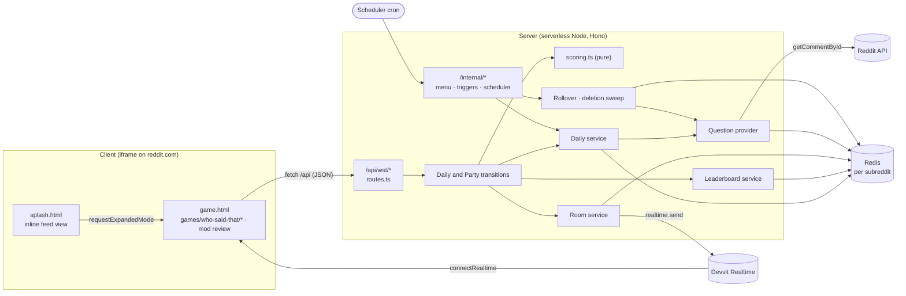

# Architecture

Stack (confirmed against the official template, Devvit 0.15.4): **Devvit Web · React 19 · TypeScript 6 · Vite 8 · Tailwind 4 · Hono (server) · Devvit Redis · Devvit Realtime · Devvit Scheduler.** No tRPC (the template's `AGENTS.md` mentioned it, but the template doesn't ship it). Plain `fetch` + shared TS types.

## 1. System diagram

## 2. Modules

| # | Module | Location | Role | Depends on |
|---|---|---|---|---|
| 1 | Client UI | `src/client/` (`splash.tsx`, `game.tsx`, `games/who-said-that/`) | Render state from the server, collect choices. Holds no answers. | shared contracts |
| 2 | Round logic | `src/server/games/who-said-that/round.ts` | Shared hints, scoring, and vote distributions | 6 |
| 3 | Question provider | `src/server/providers/questions.ts` ✅, `redditText.ts` ✅ | `QuestionRecord` from an approved case; validates and sanitizes Reddit comments; sample fallback | Reddit API, Redis |
| 3b | Approved bank + sweep | `contentBank.ts`, `contentMaintenance.ts`, `curationRoutes.ts` | Validate moderator-reviewed comments and remove unavailable snapshots | provider, Scheduler |
| 4 | Daily services | `daily.ts`, `dailyPlay.ts` | Pick five UTC cases, persist player progress and distribution | provider, Redis, round logic |
| 5 | Room service | `rooms.ts`, `partyRoutes.ts` | Membership, state machine, server deadlines, Realtime invalidations | Redis, round logic, Realtime |
| 6 | Scoring | `src/server/games/who-said-that/scoring.ts` ✅ | Pure `scoreRound()`; unit-tested | `WST` constants |
| 7 | Leaderboard | `leaderboard.ts` | Daily official completions, top 10, masked distribution and rolling personal records | Redis |
| 8 | Reddit integration | `src/server/core/post.ts` ✅, `routes/menu.ts` ✅, `routes/triggers.ts` ✅ | Create daily post, mod menu actions, install trigger | Reddit API |
| 9 | Storage | Redis only (no external DB) | See §4 | — |

Rule: **services are plain functions taking explicit inputs** (`dateKey`, `userId`), so they test with `node --test` without Devvit. Only route files import `context`.

## 3. Client vs. server responsibility

| Client | Server |
|---|---|
| Rendering, animation, countdown from server `endsAt` | Answers, shuffling, timing (`issuedAt`), scoring, distribution |
| Sends a choice and its Daily question ID or Party round index | Verifies action, identity, hint usage, and deadline |
| Caches nothing important (localStorage is wiped on app updates) | All persistent state in Redis |
| Never sees `answerSubreddit`/`threadTitle` before reveal | `PublicQuestion` vs `QuestionRecord` split enforces this |

**Auth:** identity = `context.userId` (with `reddit.getCurrentUsername()` for lobby display) on the server. Never trust a user ID from the request body. No `userId` (logged out) → read-only. Mod-only actions check `forUserType: moderator` in `devvit.json` **and** re-check mod permissions server-side.

## 4. State and Redis keys

Redis is per subreddit, has no key scan, no lists/sets → every key is derivable from (`dateKey`, `userId`, `roomCode`); sorted sets replace sets/queues. Prefix every key with the game id.

| Key | Type | Contents | TTL |
|---|---|---|---|
| `wst:q:{qid}` | JSON | Approved round snapshot, purged on source withdrawal | 7 d |
| `wst:bank:v2` | JSON | Comment and post IDs, assigned pool, approval status, difficulty, last check | 1 y metadata |
| `wst:used:v2` | JSON | Question ID → last UTC use | 90 d |
| `wst:daily:{date}` | JSON | Pack version, frozen question IDs and order, ranked or Practice status | 30 d from UTC day |
| `wst:play:{date}:{uid}` | JSON | Issued round, guesses, hints, points, completion time | 30 d from UTC day |
| `wst:lb:v2:{date}:{shard}` | JSON | One entry per official finisher with score, correct count, time and five picks | 30 d from UTC day |
| `wst:room:{code}`, `wst:room-create:{uid}:{requestId}`, `wst:room-membership:{uid}` | JSON | Party state and derived indexes for retries and account erasure | Up to 2 h |

Daily creation watches the pack, bank and recency keys. Official completion commits player progress and the player's leaderboard shard together. Rank sorts by score descending, then finish time ascending. Identical score and finish time share a rank. The board sends no account IDs or names. Guesses aggregate only from official completions and are visible only to official finishers. Distributions and the lower-score percentile require five finishers. Streaks and best records are computed from 30 days of retained official results. [Devvit Redis](https://developers.reddit.com/docs/capabilities/server/redis#transactions)

## 5. Party Room state and synchronization

- `POST /api/wst/party/create` creates a room. `POST /api/wst/party/{code}` handles join, sync, ready, start, hint, guess, and leave. Room codes carry 60 random bits. Snapshots require authenticated membership and show lobby names and room-local seats.
- The room progresses from lobby to active to reveal, with five 20-second guess windows and five-second reveals. All answers can close a round early. At the deadline the first authenticated room request applies the transition. This also applies after everyone disconnects. Fresh rounds receive a full guess window when the room is next accessed.
- Redis commits the winning state and scores before `realtime.send` broadcasts `{ version }` on `wst_room_{code}`. Clients re-fetch the member-specific snapshot for newer versions, after reconnect, at phase deadlines, and through a polling fallback. Countdown display estimates server time from the latest snapshot. The server enforces the actual deadline. See the [Devvit Realtime guide](https://developers.reddit.com/docs/capabilities/realtime/overview) and [Scheduler constraints](https://developers.reddit.com/docs/capabilities/server/scheduler).
- Active snapshots show only each viewer's own hints and locked choice. The reveal shows actual choices in aggregate, correct answer, explanation, most popular wrong choice(s), timeout count, personal points, and standings. Tied scores share a rank.
- A lost connection leaves the seat intact. Explicit lobby departure removes the seat. In-game departure preserves earned scores and passes host to the earliest remaining seat. Rooms close with fewer than two remaining active players. The browser keeps the code for refresh; members can also enter the code again.
- The `partyEnabled` installation setting gates Party only. Party selects five approved Party-only cases when available and uses a labeled sample set otherwise. Existing rooms keep their assignment. A withdrawn active case closes the room without exposing the source.

## 6. Content, rollover and deletion

1. A moderator supplies a comment ID or URL, confirms permission, chooses an exclusive pool and difficulty, and previews the sanitized public SFW comment. Approval rechecks the same preview. Legacy seeds remain candidates until approved. The app uses the Devvit Reddit client for these checks.
2. The scheduler prepares tomorrow at 23:45 UTC and starts today's validation at midnight. The first request can create and validate the pack if a job is missed. A short lease limits duplicate source checks. Transient failures leave an official pack pending validation for retry. Construction balances difficulty within eligible cases and favors unused or least-recently-used cases.
3. A ten-minute sweep revalidates eight entries per run. Known source removal or edits purge the snapshot. Installation comment and post deletion events purge known matching snapshots directly. New rounds resolve snapshots by ID. Daily never substitutes an issued slot. Withdrawal on the current or prepared day makes the whole pack Practice, skips the unavailable slot, and blocks official results uniformly.
4. The app retains only current approved snapshots and case metadata. It does not store a comment author's account ID, name, or profile. The authenticated self-service erasure and moderator-verified support flow remove player progress, board submissions, and indexed Party identifiers. Legacy Party rooms that lack the membership index expire within two hours. Devvit Web does not expose the account-delete trigger in the pinned SDK. [Devvit Rules](https://developers.reddit.com/docs/devvit_rules), [Scheduler](https://developers.reddit.com/docs/capabilities/server/scheduler)

## 7. Adding a new mini-game (e.g. Reddit Courtroom)

1. Add the id to `GameId` in `src/shared/types/game.ts`.
2. Create `src/shared/games/<id>/contracts.ts`, `src/server/games/<id>/routes.ts`, `src/client/games/<id>/`.
3. Mount with `api.route('/<short-id>', routes)` in `src/server/index.ts`; Redis prefix `<short-id>:`.
4. Choose the game per post via post data (`docs/capabilities/server/post-data.mdx`) in `game.tsx`.
5. Generalize a service (rooms, leaderboard) **only when the second game needs it**. Copy first, extract on the second use.
